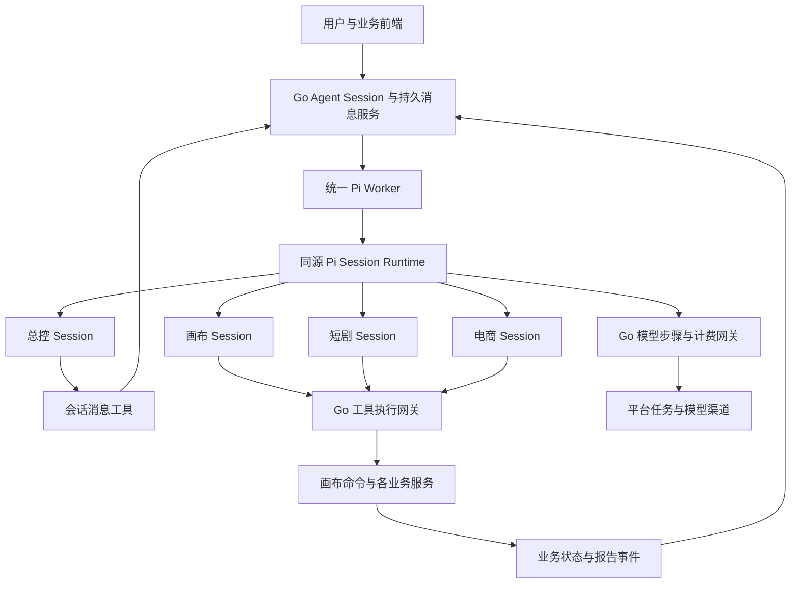

# Pi Agent 服务与总控设计对齐

> 当前设计依据为用户于 2026-11-07 明确的目标。Agent 的基本循环统一由 Pi Worker 执行，画布、短剧、电商与总控使用同一套 Pi Agent 运行机制。总控通过受控消息工具与业务 Session 协作。
> 本文取代 A0 中 R-A0-1、R-A0-3 关于非画布 Go Agent 循环的裁定，以及后续 B0–B6 计划中的对应运行器选择。历史实现和验收记录用于迁移参考。
> 冻结设计继续有效。当前接手基线、实际修复、20 条验收与 C5/C6 边界见[C0–C4 接手审计](./2026-11-08-pi-agent-c0-c4-audit.md)。实施分片见[对齐计划](../plans/2026-11-07-pi-agent-service-alignment.md)，未完成条目保持待验收。

## 1. 设计目标

将现有画布 Pi Worker 演进为平台全业务 Agent 服务。总控、画布、短剧和电商是这个服务上的不同 Agent 定义，分别拥有自己的 Session、提示、工具和授权。

所有 Agent 的模型与工具循环、Pi 会话管理、原生压缩、检查点及恢复由同源 Pi 执行器承接。Go 服务承接身份、消息投递、租约、模型收费准入、工具校验、业务执行和状态持久化。

总控拥有独立 Pi Session。它根据用户目标选择已授权的业务 Session，发送消息，接收明确的业务回报，再决定后续消息。用户可直接进入该业务 Session，双方输入经同一个持久消息入口排序。

## 2. 与现有画布 Agent 对齐的执行模型

Pi Worker 可以部署多个实例，领取同一通用执行协议的工作。一次 Session 同时由一个有效写者推进，实例接管依据持久 lease epoch 和检查点。

Go 的平台任务 Worker 负责实际模型请求和媒体生成。Pi 负责发起下一模型步骤、执行工具回调、处理模型结果和原生会话循环，模型访问与费用通过 Go 网关发生。

## 3. 可复用的画布执行链

当前画布实现已经提供可复用的执行机制。

| 当前位置 | 可复用能力 | 通用化方向 |
| --- | --- | --- |
| `agent/src/runner.ts` | `createAgentSession`、SessionManager、模型 provider 桥接、检查点、工具批次、恢复、压缩 | 抽出通用 Session Runtime，由业务 Host 提供上下文与工具回调 |
| `agent/src/worker-runtime.ts` | 租约丢失、终态、恢复上报、错误边界 | 所有业务使用同一执行错误边界 |
| `agent/src/bridge.ts` | claim、snapshot、模型步、工具批次、工具回执、检查点 | 演进为携带 Session、Scope 和执行授权的通用 Bridge |
| `agent/src/session-tools.ts` | 工具 Schema 转 Pi 注册、动态撤权、调用回调 | 接收当前 Session 的有效工具集，回调统一 Go 工具网关 |
| `agent/src/native-compaction.ts` | Pi 原生压缩准备、提交与恢复 | 按 Session 保存压缩分支与版本，费用关联本次运行 |
| Go 的 `cloud_agent_pi_*` | 模型准入、持久 Pi entries、工具状态、版本与租约 | 提取通用宿主服务，画布专属规则进入画布适配器 |

现有代码中的 `PiSnapshot.request.canvasId` 已可选，但创建运行仍读取画布，Pi Session 持久行仍有必需 CanvasID，Bridge 调度键也带画布身份。需要同时通用化入口、持久身份与调度，形成实际可运行的非画布 Pi Session。

## 4. 职责分配

| 层 | 职责 |
| --- | --- |
| Pi Agent Runtime | 驱动模型与工具循环、会话分支、检查点协调、原生压缩与执行恢复 |
| Pi Worker | 领取 Session 运行、资源与并发调度、维持租约、执行 Runtime 并上报结果 |
| Go Agent 服务 | Definition、Session、消息队列、Scope、执行授权、持久状态、事件和可审计回执 |
| Go 模型与计费网关 | 结构化模型步骤、渠道与模型选择、预算预留、唯一账单、结算和资源交付 |
| Go 工具网关 | 验证执行身份、工具权限、工作与目标版本、审批、幂等及业务事务 |
| 业务适配器 | 暴露业务上下文与工具，调用原有画布、短剧、电商和资产服务 |
| 总控 Agent | 解释用户目标、选择授权业务 Session、发送消息、阅读显式回报、协调后续工作 |
| 前端 SDK | 会话目录、收发消息、订阅事件、审批和费用读取，提供统一交互 |

工作单、Assignment、预算树和报告是执行治理数据。总控模型通过工具使用这些能力，业务 Session 的实际思考与操作由其自身 Pi 运行推进。

## 5. 总控与业务 Session 的消息合同

推荐给总控注册以下角色工具，具体 Schema 在实施 C0 固化。

| 工具 | 输入与效果 |
| --- | --- |
| `agent_sessions_list` | 列出当前用户与根工作授权范围内的业务 Session 及可公开状态 |
| `agent_session_open` | 按 Definition、Scope 和任务目的选择或创建业务 Session，返回稳定 SessionID |
| `agent_session_send` | 向指定 Session 发送文本和授权资源引用，返回 MessageID 与受理回执 |
| `agent_work_read` | 读取本工作树的进度、明确发布的报告、资源与费用 |
| `agent_request_user` | 持久化用户问题，等待真实输入后唤醒当前总控 Session |

`agent_session_send` 的执行身份来自当前总控运行。目标 Session 的 owner、Scope、授权范围及关联工作在 Go 事务中核对。发送者角色由服务端写入，消息正文只提供业务要求。

发送与目标消息入队、工作绑定、outbox 和执行唤醒通过持久幂等键关联。返回 accepted 表达消息已受理，业务完成依据后续报告与业务状态表达。

业务 Pi Session 通过共享报告工具或已授权业务事件发布明确回报，Go 将回报写入总控 Session 的输入队列。总控收到该事件后开始下一次 Pi 运行。等待业务期间工作由事件推进。

总控获取显式回报及授权引用。业务 Session 的私有历史、笔记和压缩摘要按自己的边界加载。

## 6. Session、运行与上下文隔离

1. Session 的 owner、Definition、Application、SpaceType、SpaceID 创建后固定。
2. Pi Session、entries、active leaf、摘要、技能目录和历史回执均与稳定 SessionID 绑定，每次读取与恢复核对归属。
3. Pi Worker 的会话写者按 Session 协调。业务空间相同的两条独立 Session 具有各自的历史与运行状态。
4. 每次执行具有完整的 `RunID + SessionID + MessageID + LeaseEpoch + AuthorizationVersion`。工作执行额外绑定 WorkItem、Assignment epoch 与 BudgetGrant。
5. 用户和总控对同一业务 Session 的消息进入同一有序队列，source、MessageID 和工作版本可追踪。
6. 默认按任务目的建立业务会话，继续已有会话时显式选定目标 Session。每次执行的费用归属由消息授权绑定决定，Session 的历史工作字段只提供目录与展示信息。
7. Pi 的 SessionManager 从 Go 持久 entries 恢复，公共会话消息与 UI 历史作为受控投影读取，二者的关联可去重和追溯。

跨 Session 共享资料通过业务文档发布与授权资源引用完成。Pi 的技能和文件目录从当前运行冻结的材料构建，宿主机能力按显式授权开放。

## 7. 工具如何分发

工具注册沿用画布 `SessionToolDisclosure → Pi extension → Go tool callback` 的机制。

1. Go 根据 Definition、角色、Scope、用户权限和工作授权求出有效工具集合，冻结本次运行的工具 Schema 与版本。
2. Snapshot 将有效工具、提示、技能和执行身份交给 Pi Worker。
3. 通用 Pi 工具注册模块将这些工具注册到该 Pi Session。
4. Pi 选择并调度工具调用，工具回调携带本次运行、调用和租约身份返回 Go。
5. Go 工具网关重新核对授权，按业务适配器调用现有服务，将持久回执返回 Pi。

角色工具、业务工具和共享报告工具使用同一注册与执行机制。总控的主要能力是会话通信，画布工具调用 commands，短剧与电商工具调用各自业务服务。

撤权即时影响 Go 准入及 Pi 的有效工具集合。扩大工具或授权范围生成新的明确授权与运行合同。

## 8. 计费与业务执行

每笔模型、压缩和媒体费用关联用户、根工作、子工作、Assignment、Session、Run 和具体操作。平台计费服务提供预留、实收、退款、在途及待核对状态。

总控 Session 的推理使用根工作授权，业务运行使用对应授权。用户在原业务 Session 内补充要求，使用该消息明确绑定的工作预算。独立咨询建立独立费用授权。

采用当前确认的 1,000,000 microcredits 根工作上限与 100,000 microcredits 单次审批阈值，策略由 Go 管理。新生成、重试、审阅后自动制作等入口持续传递执行授权。

业务写入、目标版本检查与操作回执共享原子边界，或通过业务服务的持久操作标识协调。任务提交、生成完成、资源交付和业务采用分别记录。工作完成依据业务目标及所需操作集合判定。

## 9. 当前代码的迁移归属

| 当前实现 | 对齐后的归属 |
| --- | --- |
| Definition、Session、Scope、WorkItem、Assignment、BudgetGrant | 通用 Go 控制面 |
| 业务适配器与已有业务服务 | 通用 Pi 工具回调的服务端实现 |
| 输入、outbox、审批、报告、TS SDK 与会话面板 | 统一消息和会话体验的基础 |
| `agent_runner.go` 的轮次调度 | 演进为面向 Pi 的待执行消息调度、状态投影与事件唤醒 |
| `agent_business_turn.go` 的模型与工具循环 | 迁入现有同源 Pi Runtime，按持久执行路由完成切换 |
| Go 的自建会话摘要循环 | 迁入 Pi 原生压缩与已有 Go 压缩准入、持久化桥接 |
| `agent_supervisor_tools.go` 的角色行为 | 收敛为 Session 目录、打开、发消息和读取业务事实的工具 |
| 现有画布 runner 与 Pi 恢复链 | 通用化的执行内核与画布 Host 适配 |

上一轮审查的预算传递、跨工作树权限、Assignment 栅栏、业务回执原子性、完成条件、UI 隔离和迁移清单问题继续作为验收输入。历史 Go 摘要的连续记忆用例转为 Pi 原生压缩回归。

## 10. 核心验收场景

用户提出一个涉及短剧与电商的目标，总控 Pi Session 向两个独立业务 Session 发消息。两个业务 Session 由同一 Pi Worker 服务调度，各自调用业务工具。用户直接在短剧 Session 补充要求，工作持续推进，明确报告唤醒总控 Pi Session。整个过程可以跨 Worker 重启恢复，模型、工具、资源和费用均可核对。

验收时应观察到各 Session 均有 Pi entries、租约、模型与工具检查点及恢复证据。将 Pi Worker 停止后，新 Agent 轮次保持可审计的待执行状态。恢复 Worker 后从原消息与检查点继续，既有工具操作与收费各执行一次。
