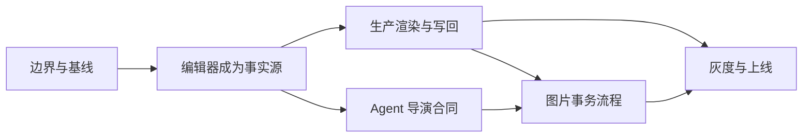

# DirectorDesk 预演台上线规划

> 目标：把当前“浏览器运行时 + Agent 合同验证”的集成骨架，推进到可灰度、可回退、可观测的生产版本。
>
> 适用范围：Web/桌面端预演台、Agent 导演工具、图片到可编辑 3D 预演场景、白膜预览任务和画布写回。

## 迁移边界

本次上线不是把 DirectorDesk 整体搬进无限画布，而是迁移“当前项目的导演决策和可编辑预演结果”。画布只负责当前戏段的场景、镜头、时间轴、Agent 控制、图片生成入口和任务结果展示；DirectorDesk 的桌面工程管理能力继续留在外部产品或后续服务中。

### 必须进入画布的能力

- 演员、道具、摄影机、环境的摆放、变换、可见性和选择。
- 演员与摄影机走位路径、速度、时间范围和基本路径编辑。
- 镜头列表、景别、焦段、运镜、切镜和时间轴。
- 导演视图、摄影机取景预览和基础白膜预览。
- Agent 的场面调度、镜头设计、连续性检查、预览和交付工具。
- 图片节点到可编辑 3D 预演场景的入口。
- 任务状态、视频/构图帧产物和画布资源写回。

### 不进入画布的能力

- Electron 工程文件、默认目录、自动更新和本机 MCP 配置。
- DirectorDesk 内置 AI、原始 MCP 工具和第二套权限/计费体系。
- FBX/OBJ/GLB 导入、动作库和资产入库；画布只引用已授权的全局资产。
- 物理、碰撞、惯性、布娃娃和自动避障等高级计算能力。
- 深度视频、灰度曲线、粒子、镜面、形变等高级画面效果。
- 历史版本、工程级多戏段管理、批量导出和素材包交付。
- 插件安装、插件市场和 DirectorDesk 专属扩展机制。

这些能力可以作为全局资产中心、任务中心、后台服务或独立 DirectorDesk 工作区继续建设，但不能成为本次画布替换的阻塞项，也不能引入第二套持久化事实源。

## 上线定义

上线版本必须同时满足以下条件：

1. DirectorDesk 运行时是预演编辑器的唯一交互事实源。旧 `CanvasPrevisWorkbench` 只能作为受 feature flag 控制的回退实现，不能与新运行时并行写入。
2. 已有 `PrevisScene` 打开、编辑、保存、重开后，演员、道具、摄影机、路径、镜头切换、时间轴和扩展字段不丢失。
3. Agent 可以完成“场面调度 → 镜头设计 → 连续性检查 → 预览 → 交付”的导演工作流，且每次写入都经过权限、审批、revision、requestId、CAS 和资源归属校验。
4. 图片入口先取得服务端图片检查回执，再以原子事务创建或更新场景；任一步失败、取消或超时，画布都不留下半成品。
5. 白膜预览走现有任务队列、renderer、资源记录和画布写回，具备取消、重试、幂等和终态可追踪能力。
6. 有真实浏览器、真实图片模型、真实后端任务和灰度环境验收记录；基础回归失败项已隔离、修复或明确豁免。
7. 出现严重错误时，可以在不改变 `PrevisScene` 数据格式的前提下切回旧预演台。

## 当前判断

当前版本适合内部演示和受控 Canary，不具备生产发布条件。主要差距集中在四个闭环：

- **编辑闭环**：目前可见的 DirectorDesk 运行时仍是基础三维预览，旧工作台仍承载主要编辑和保存逻辑。
- **渲染闭环**：浏览器 asset/render bridge 已存在，但尚未完成与真实 `previs_preview` 任务、终态轮询和资源写回的生产接线。
- **图片闭环**：入口能创建 Agent 预填请求，但仍需服务端图片回执、阶段暂存、原子提交和回滚。
- **发布闭环**：缺少统一开关、观测指标、灰度比例、回退演练和真实环境验收。

### 已执行进度

- **P0 已落地第一切片**：服务端新增 `directorDeskPrevisMode`，支持 `off`、`canary`、`on`，未知值安全回退到 `off`；管理员功能开放面板可直接切换。
- **P1 已落地第一切片**：DirectorDesk 运行时可在草稿变化时实时同步场景文档，并保留旧工作台作为回退和编辑宿主。
- **P1 尚未完成**：DirectorDesk 仍未接管完整视口、时间轴、检查器和提交事件，`on` 模式暂不能作为生产开关使用。
- **P3 已落地第一切片**：导演工具成功回执统一携带 `requestId`、`callId` 和场景 `revision` 快照令牌。
- **P4 已落地第一切片**：图片入口带服务端识别工作流标识，服务端拒绝跳过识图回执的场面调度、镜头设计和连续性检查。
- **P4 已落地第二切片**：Agent 失败终态会尝试通过现有 mutation 链恢复未通过连续性检查的导演草稿，并在检测到并发修改时放弃静默覆盖。
- **P4 尚未完成**：仍需要独立 staging draft、成功后的原子 commit，以及取消/超时路径的回滚验收；当前不能把顺序校验和失败回滚切片当成完整事务闭环。
- **P2 已落地第一切片**：灰度/全量 DirectorDesk 入口的白膜按钮接入现有 canvas command `previs-tasks`，使用任务队列、幂等 operationId 和后台资源写回；旧模式继续使用本地录制回退。
- **P2 尚未完成**：仍需真实 renderer、任务终态、取消、重试和资源写回的浏览器端端到端验收。
- **P5 基线结果**：DirectorDesk/Agent focused、后端 app/handler、Web typecheck 和 renderer tests 通过；全量 Web 为 2307 项中 2298 通过、9 个既有路由/资源相关失败，需在 RC 前单独处理或登记豁免。
- 已通过：DirectorDesk feature flag focused test、workbench lifecycle test、admin regression test、Go feature availability test、Web typecheck。

## 阶段计划

### P0：冻结边界与建立上线基线

**目的**：防止继续堆功能时扩大数据和回退风险。

**工作项**

- 固化 `PrevisScene`、`previsScenes`、任务状态和资源写回为唯一持久化事实源。
- 定义 DirectorDesk 支持矩阵：实体、镜头、路径、cuts、时间轴、扩展字段、暂不支持字段。
- 增加统一 feature flag：`directorDeskPrevis` 至少支持 `off`、`canary`、`on` 三态，并记录用户/项目级命中情况。
- 明确旧工作台回退规则：只允许从入口切换，不允许同一场景同时由两套编辑器写入。
- 建立基线测试和失败清单，区分本次功能回归与仓库已有失败。

**退出条件**

- 有一份字段支持矩阵和回退决策表。
- 同一场景在新旧实现间只能选择一个写入者。
- 所有新请求和任务日志带 `requestId`、`sceneId`、`revision`、`projectId`。

### P1：完成画布核心导演编辑器迁移

**目的**：让 DirectorDesk 从“可见预览”升级为真正可编辑、可保存的预演台。

**工作项**

- 只移植画布范围内的视口、时间轴、镜头列表、属性检查器、选择/撤销/重做等 browser-safe UI。
- 不迁移工程文件、插件、MCP、资产导入、物理和高级效果面板。
- 实现 `SceneDocument ↔ PrevisScene` 双向增量同步，不再只在初始化时转换。
- 让用户提交编辑时进入现有 save coordinator；禁止直接写 localStorage 或绕过 CAS。
- Agent 更新场景时，按 `sceneId/revision` 刷新 DirectorDesk 文档并恢复选择、时间轴和当前镜头。
- 增加编辑事件桥：`documentChanged`、`commitRequested`、`commitSucceeded`、`commitConflict`、`dispose`。
- 明确不支持字段的降级策略：保留在影策扩展区，重新打开时可恢复。

**验收**

- 旧场景打开 → 拖动演员 → 调整摄影机 → 编辑路径 → 切换镜头 → 保存 → 关闭 → 重开，结果一致。
- 撤销/重做、Agent 补丁、并发 revision 冲突均有可重复测试。
- 旧工作台不再是默认渲染内容；它只在 flag 关闭或新运行时故障时出现。
- 画布核心范围之外的 DirectorDesk 功能不会阻塞 P1 验收。

### P2：接通生产资源、渲染和写回链路

**目的**：把浏览器预览与现有任务系统连成可追踪的生产闭环。

**工作项**

- 将 asset loader 接入真实资源授权接口，只接受资源 ID/受控文件端点；拒绝 storage key、机器路径和任意 URL。
- 将 render bridge 接入 `previs_preview`、任务队列、renderer、资源记录和画布节点写回。
- 明确前端采样预览与后台白膜任务的边界：前者用于交互反馈，后者用于最终产物。
- 高级导出（深度视频、批量导出、素材包）不纳入本次上线；画布只提交标准白膜任务并展示结果。
- 实现任务状态映射：排队、运行、成功、失败、取消、过期，并能从任务中心重新进入预演台。
- 实现取消传播、失败重试、重复提交去重、写回幂等和 renderer 超时诊断。
- 在服务端记录 render input snapshot，确保任务执行期间场景版本固定。

**验收**

- 同一个 `requestId` 重复提交不会产生重复资源。
- 取消任务后 renderer、任务记录和 UI 最终状态一致。
- renderer 成功后视频/构图帧写回画布；失败后不创建伪成功节点。
- 资源权限、配额和跨项目访问测试全部通过。

### P3：完成 Agent 导演工作流合同

**目的**：让 Agent 真正按导演工作方式控制预演台，而不是只包装 CRUD。

**工作项**

- 固化六个高层工具的输入输出 schema：`director_block_scene`、`director_design_shot`、`director_draw_action`、`director_check_continuity`、`director_preview_shot`、`director_handoff_shot`。
- 所有写工具统一返回 `requestId`、输入 `revision`、输出 `revision`、approval preview、机器可读错误和变更摘要。
- 扩展画布核心范围内的连续性检查：地面/路径表面、空间关系、遮挡、镜头轴线、前后镜头接拍、角色/道具状态。
- 自动避障、物理模拟和高级动作求解只作为后续 Agent/后台能力，不作为画布上线门槛。
- 将检查结果分为阻断错误、需确认警告和建议项；自动修复必须再次经过审批。
- 同步 Agent harness schema、工具描述、Web 工具卡片和错误分类。
- 限制工具顺序：图片工作流必须先完成图片检查，再允许场面调度和镜头设计。

**验收**

- stale revision、无权限资源、未审批写入、越界实体数量、错误工具顺序均被拒绝。
- Agent 能从空场景完成一段可编辑镜头，并从已有场景增量修改。
- 连续性检查可以产出可解释诊断，且不会静默覆盖用户修改。

### P4：完成图片到预演台的事务化流程

**目的**：保证“一键生成”真的可用且不会产生脏数据。

**工作项**

- 前端提交图片资源 ID、场景 ID、模型能力和幂等键；不把图片 URL 或 token 交给模型作为事实依据。
- 服务端执行图片归属校验并生成一次性 `imageInspectionReceipt`，记录模型、资源版本、尺寸、摘要和过期时间。
- 采用 staging scene 或 transaction draft：`inspect → block → design → continuity → preview/commit`。
- 只有连续性检查通过或用户明确确认警告后，才把 draft 原子提交到正式 `PrevisScene`。
- 失败、取消、超时和过期全部清理 draft，不改变原场景和画布结构。
- 图片不支持、模型不可用、读取失败时给出明确错误和可重试动作。
- 入口支持“打开 Agent 并自动提交”与“仅填充草稿”两种模式，默认使用前者并允许用户中止。

**验收**

- 正常图片可生成 actor、道具、环境、主镜头和连续性报告，并可继续手动编辑。
- 图片读取失败或模型不支持时，正式场景完全不变。
- 重复点击和网络重试不会生成重复场景或重复实体。

### P5：质量、观测和灰度发布

**目的**：在真实流量中验证性能和可回退性。

**工作项**

- 增加指标：运行时初始化成功率、编辑提交成功率、CAS 冲突率、图片流程完成率、任务成功率、写回失败率、平均耗时、WebGL 崩溃率。
- 增加结构化日志和关联字段：`requestId`、`projectId`、`sceneId`、`revision`、`taskId`、`runtimeVersion`。
- 做浏览器矩阵验收：桌面 Chromium、Chrome、Edge；覆盖 WebGL 不可用、低显存、网络中断、刷新和多标签页。
- 将未迁移功能列为产品边界验证项，确保入口不会误显示工程管理、插件、MCP 或高级导出操作。
- 使用真实图片输入模型执行端到端验收，记录模型能力和限流行为。
- 先内部账号，再小比例 Canary，再逐步放量；每级至少观察一个完整任务生命周期。
- 演练回退：关闭 flag 后旧工作台能打开相同 `PrevisScene`，新运行时生成的扩展字段不影响旧工作台。
- 清理或隔离当前仓库已有全量测试失败，确保发布阻断项可判定。

**上线门槛**

- P1–P4 的验收用例全部通过。
- Canary 期间没有 P0/P1 数据一致性、权限、任务写回问题。
- 关键指标达到预设阈值，且回退开关经过实际演练。
- 发布说明包含已支持能力、已知限制、回退方式和监控面板。

## 依赖关系

P1 是核心阻塞点。在 P1 完成前继续迁移工程管理、插件、MCP 或高级效果，会把双写风险和范围失控带入生产。图片和渲染功能可以并行准备接口，但必须以 P1 的场景/镜头数据合同为准。

## 风险与回退

| 风险 | 影响 | 预防 | 回退 |
|---|---|---|---|
| DirectorDesk UI 迁移不完整 | 用户无法编辑或保存 | 先完成编辑事件桥和 round-trip 测试 | 关闭 flag，回到旧工作台 |
| 适配器丢字段 | 场景重开后内容变化 | 字段矩阵、金丝雀场景、快照比对 | 保留原 `PrevisScene`，禁止覆盖提交 |
| Agent 并发覆盖 | 用户修改丢失 | revision/CAS、requestId、冲突 UI | 拒绝提交并重新读取 |
| renderer 失败或重复写回 | 资源污染、假成功 | 任务幂等键、状态机、终态校验 | 任务标记失败，不写成功节点 |
| 图片分析失败 | 半成品场景 | receipt + staging + 原子提交 | 丢弃 draft，保留原场景 |
| WebGL/性能问题 | 页面崩溃或卡顿 | 资源预算、dispose、浏览器矩阵 | 自动降级旧工作台 |
| 新旧格式并存 | 长期维护和数据分叉 | 单一事实源、单一入口、flag 过渡期 | 仅保留受控回退，不允许双写 |

## 建议的交付顺序

先完成 P0、P1，再完成 P2 和 P3，随后把 P4 作为单独的端到端里程碑，最后进入 P5 灰度。每个阶段都应以“可演示的垂直切片 + 自动化验收 + 可回退”为结束条件，不以代码合并作为完成标准。

当前版本应标记为 `internal preview`，只有 P1–P4 全部验收后才进入 `release candidate`，P5 灰度通过后才可标记为 `production`。
