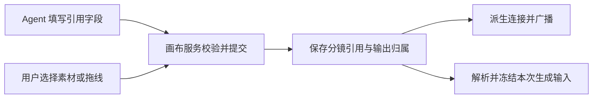

# 分镜引用字段与画布连接管理：实施可行性评估

结论：可行，建议实施。分镜业务范围属于中等规模重构，现有上游已经具备引用字段、生成输入解析和部分自动建线能力。实施重点是建立统一的数据权威和服务端同步入口，处理引用删除、产物归属和历史任务。若扩大到所有类型节点都禁止 Agent 连线，需进一步补齐各类节点的声明式输入合同。

评估日期：2026-10-18。基线为上游 AetherNo2332/open-ai-canvas4AI 的 main，固定提交 [a6495805](https://github.com/AetherNo2332/open-ai-canvas4AI/tree/a6495805efc19101b2a8aaaefaded4722a5e7766/)，提交时间为北京时间 2026-10-18 17:13:20。分析结束前再次读取 main，提交未变化。

本轮通过 GitHub 连接器读取该提交的 40 个相关源码／测试文件，并对比本地 open-ai-canvas-source 的 ea426f48：远端领先 36 个提交。Git 拉取失败是配置的本机代理 127.0.0.1:7897 未响应，随后通过连接器取得了远端代码。源码快照保存在工作区 .local/research/upstream-a6495805/。没有合并分支、修改产品代码、操作服务器或容器；本轮是静态评估，没有运行测试、构建或真实生成。

我对目标的理解是：Agent 表达“这个镜头使用哪些素材、这个产物属于哪个镜头”，画布服务负责验证关系、保存数据并展示连接。Agent 不再填写 edge ID、端口或操作 connect_nodes。手工拖线仍可作为用户编辑引用的入口。



现有代码提供了这些基础：

| 能力 | 当前上游证据 | 对方案的意义 |
| --- | --- | --- |
| 分镜行引用字段 | StoryboardAssetBinding 已有 nodeId、role、priority；分镜表有 referenceNodeIds，行有 assetBindings、characters 和输出节点 ID。[类型定义](https://github.com/AetherNo2332/open-ai-canvas4AI/blob/a6495805efc19101b2a8aaaefaded4722a5e7766/web/src/types/canvas.ts#L95-L152) | 可复用已有业务结构。 |
| Agent 可编辑结构化素材引用 | StoryboardRowFields 已允许 assetBindings 和 characters；输出 ID、任务状态不在可写合同中。[字段合同](https://github.com/AetherNo2332/open-ai-canvas4AI/blob/a6495805efc19101b2a8aaaefaded4722a5e7766/backend/internal/canvas/capability/rows.go#L8-L25) | 合法的引用数组已能通过分镜创建／编辑工具提交。 |
| 引用有基本校验 | 服务端检查节点位于当前画布、引用不重复、素材类型与角色一致。[引用校验](https://github.com/AetherNo2332/open-ai-canvas4AI/blob/a6495805efc19101b2a8aaaefaded4722a5e7766/backend/internal/app/cloud_agent_storyboard.go#L424-L473) | 可以扩展现有校验，继续在生成前核验真实资源权限和就绪状态。 |
| 生成时自动建线 | generate_media 接受 sourceNodeId、referenceNodeIds；创建草稿或任务节点时自动维护输入连线。[生成参数](https://github.com/AetherNo2332/open-ai-canvas4AI/blob/a6495805efc19101b2a8aaaefaded4722a5e7766/backend/internal/app/cloud_agent_media.go#L98-L119)、[自动建线](https://github.com/AetherNo2332/open-ai-canvas4AI/blob/a6495805efc19101b2a8aaaefaded4722a5e7766/backend/internal/app/cloud_agent_media.go#L930-L947) | 普通媒体生成已经具备“传字段、系统建线”的做法。 |
| 分镜产物有关系类型 | 已支持 storyboard-output 和 storyboard-asset-reference，输出身份由系统根据真实端点维护。[连接合同](https://github.com/AetherNo2332/open-ai-canvas4AI/blob/a6495805efc19101b2a8aaaefaded4722a5e7766/backend/internal/canvas/commands/native_connections.go#L29-L52) | 可以保留现有关系语义，改由画布服务生成。 |
| 已有事务、事件和撤销基础 | 命令规划计算文档差异和逆向差异，命令服务在事务中校验版本并保存。[规划](https://github.com/AetherNo2332/open-ai-canvas4AI/blob/a6495805efc19101b2a8aaaefaded4722a5e7766/backend/internal/canvas/commands/planner.go#L53-L107)、[提交](https://github.com/AetherNo2332/open-ai-canvas4AI/blob/a6495805efc19101b2a8aaaefaded4722a5e7766/backend/internal/canvas/commands/service.go#L396-L459) | 引用与派生连接应在同一次事务中进入差异和历史记录。 |

目前仍有五个缺口。

1. **引用字段和连线同时决定生成输入。** storyboardRowReferenceNodeIds 会合并表级 referenceNodeIds、行级 assetBindings、角色匹配、指向行的连线和指向输出节点的普通连线。[当前计算](https://github.com/AetherNo2332/open-ai-canvas4AI/blob/a6495805efc19101b2a8aaaefaded4722a5e7766/web/src/lib/canvas/canvas-storyboard-materializer.ts#L7-L30)。静态反例：把某行 assetBindings 清空，只要旧的“素材 → 分镜行”连接仍存在，该素材还会进入返回的 referenceIds。迁移后必须停止从已接管的派生连接反向补入引用。

2. **字段修改尚未统一触发连接同步。** Agent 分镜编辑路径更新 rows 后保存；原生命令 editStoryboard 也只更新表格。前端的 reconcileStoryboardTargetConnections 主要在创建／准备分镜图和视频节点时调用。[Agent 编辑](https://github.com/AetherNo2332/open-ai-canvas4AI/blob/a6495805efc19101b2a8aaaefaded4722a5e7766/backend/internal/app/cloud_agent_storyboard.go#L270-L330)、[命令编辑](https://github.com/AetherNo2332/open-ai-canvas4AI/blob/a6495805efc19101b2a8aaaefaded4722a5e7766/backend/internal/canvas/commands/structured.go#L122-L183)、[前端调用](https://github.com/AetherNo2332/open-ai-canvas4AI/blob/a6495805efc19101b2a8aaaefaded4722a5e7766/web/src/pages/canvas/use-canvas-storyboard.ts#L276-L322)。因此，引用字段能写入不等于连接已经即时同步；应覆盖没有浏览器打开时的 Agent 写入。

3. **Agent 生成缺少分镜行归属。** 当前 cloudAgentMediaArgs 没有 storyboardNodeId／storyboardRowId。sourceNodeId 表达文本输入，不能唯一标识表内某行。[参数结构](https://github.com/AetherNo2332/open-ai-canvas4AI/blob/a6495805efc19101b2a8aaaefaded4722a5e7766/backend/internal/app/cloud_agent_media.go#L98-L119)。自动输入建线也未设置分镜输出关系，所以要补上产物属于哪个镜头的语义参数。

4. **存在多条写入路径。** Agent 通过 app 内的分镜 mutation 保存，原生命令通过 commands，前端还有编辑器差异转换。旧的前端 buildAgentStoryboardOperations 甚至仍只接受文本和时长字段。[Agent 分派](https://github.com/AetherNo2332/open-ai-canvas4AI/blob/a6495805efc19101b2a8aaaefaded4722a5e7766/backend/internal/app/cloud_agent_runtime.go#L1937-L1948)、[前端旧校验](https://github.com/AetherNo2332/open-ai-canvas4AI/blob/a6495805efc19101b2a8aaaefaded4722a5e7766/web/src/lib/canvas/canvas-storyboard-operations.ts#L31-L69)。同步逻辑应放入画布领域的纯函数，由各入口调用；不能只在 React effect 或单个工具里修补。

5. **Agent 仍能操作连接。** canvas_apply_ops 的 schema 公开 connect_nodes、delete_connection、update_connection，工具说明也教 Agent 使用它们。[schema](https://github.com/AetherNo2332/open-ai-canvas4AI/blob/a6495805efc19101b2a8aaaefaded4722a5e7766/backend/internal/app/cloud_agent_tools.go#L696-L734)、[工具说明](https://github.com/AetherNo2332/open-ai-canvas4AI/blob/a6495805efc19101b2a8aaaefaded4722a5e7766/backend/internal/app/agent-tool-descriptions.md#L116-L126)。要同时收紧模型可见合同和服务端执行入口，保留画布内部连接能力供系统使用。

推荐的字段与关系规则如下。这些是本评估提出的实现建议，尚未实施。

| 对象 | 推荐合同 |
| --- | --- |
| 表级共享素材 | 复用 storyboard.referenceNodeIds；为 Agent 增加明确的表级引用编辑入口。目前分镜创建 schema 和行 patch 没有提供该写法。 |
| 行级素材 | 复用 assetBindings: [{ nodeId, role, priority }]；characters 可保留表演／角色描述语义，素材身份统一进入同一个解析器。 |
| 普通媒体节点 | 复用生成入口的 referenceNodeIds，文本来源仍用 sourceNodeId。要支持未发起生成的普通节点引用编辑，再增加相应的节点输入字段合同。 |
| 分镜生成请求 | 为 generate_media 增加 storyboardNodeId、storyboardRowId；输出槽位从 mode 推导。服务端从该行解析有效引用，避免 Agent 再抄一份素材列表。 |
| 分镜生成中的额外引用 | 若确有需求，另设有明确合并语义的字段；不要让同一个 referenceNodeIds 同时表示“覆盖分镜引用”和“追加引用”。 |
| 输出归属 | imageNodeId／videoNodeId 继续由系统在接纳输出节点时写入，Agent 不直接改。已有产物另行附到镜头时，提供语义绑定动作，由服务端检查并生成关系。 |
| 素材库资产 | 第一阶段保持“先导入／绑定到当前画布节点，再以 nodeId 引用”。如需直接引用 assetId，需增加有权限和版本校验的类型化选择器，不能把 nodeId 与素材库 ID 混用。 |

Agent 编辑一行可以沿用现有工具和字段：

```json
{
  "snapshotHash": "<最新画布快照标识>",
  "nodeId": "storyboard-1",
  "action": "update",
  "rowId": "shot-1",
  "patch": {
    "assetBindings": [
      { "nodeId": "hero-card", "role": "character", "priority": 100 },
      { "nodeId": "street-image", "role": "environment", "priority": 90 }
    ]
  }
}
```

该调用使用 canvas_edit_storyboard。nodeId、rowId 和素材 ID 必须来自真实读取结果。现有合同已能接受这种结构，但完整的连接同步还需实现。把 assetBindings 设为 [] 应表示清空该行的显式绑定；表级共享引用继续生效。字段未提供表示保持原值，避免部分更新意外清空。

核心实现可以分为三步：

1. **统一解析和同步。** 在 backend/internal/canvas 的领域层增加纯函数，读取表级引用、行级素材、明确的角色／首帧选择和系统输出归属，得到有效输入与期望连接。按节点索引处理，避免每条引用重复扫描全画布。更新字段后、计算 Diff／Inverse 之前执行同步；Agent app 路径、原生命令、拆镜结果落库及任务节点创建都调用同一逻辑。

2. **补齐产物归属与 Agent 合同。** 为分镜生成加入表 ID 和行 ID，让系统维护输出身份及关系。为共享引用、已有产物归属和必要的普通节点输入提供语义字段／动作。然后从 Agent schema 移除连接操作，并在执行层拒绝模型直接操作边；画布内部和用户操作继续使用连接领域能力。同步更新工具描述、合同快照／缓存、审批预览及相邻测试。

3. **统一用户交互并完成迁移。** 用户选素材、拖线和断线都转换成相同的业务引用编辑；服务端返回权威字段与连接差异。旧画布在切换时做一次规范化：识别已有行端口、关系类型和字段，保留有明确业务含义的引用；冲突不能静默并集，也不能全量清掉普通连线。完成接管后，生成输入只从业务字段解析，不再常态读取派生边回填字段。

同步必须满足以下约束：

- **服务端是权威。** 不能依赖分镜 UI 是否打开；字段和派生边必须一起保存、广播、撤销和重做。
- **派生边可识别且幂等。** 复用现有 relation、storyboardRowId，并为接管范围补充明确的归属标识或等效索引。以“画布／分镜表／行／角色／端点”为稳定身份依据，保留未变化连接的 ID 和用户锚点，避免每次重建引发事件噪声。
- **用户断线要有业务含义。** 从显式行引用断开就删除相应绑定；共享引用需要在表级修改。首帧、尾帧、角色图等语义不能只靠普通连线推断；接管后应使用相应选择字段。派生边被单独删掉而字段未改，会在下一次同步恢复。
- **输入类型和顺序一致。** 表级上下文可能包含文本，应分别解析为文本上下文和媒体输入，不能把文本节点直接混入媒体 referenceNodeIds。引用顺序同时影响提示词中的 @图片1 等标记和模型数组。角色、优先级、去重与同优先级排序要在服务端确定，预览和生成使用同一结果。行合同允许 100 个绑定，生成工具上限 16，实际模型可能更低；超限应在费用／任务提交前明确拒绝，不能静默截断。
- **提交的任务输入冻结。** 修改分镜只影响草稿或下一次生成，不能改写已提交请求的素材及历史来源。保留现有资源、能力、价格和审批准入逻辑，并把分镜行依赖纳入已有冲突校验。
- **删除不等于销毁产物。** 删行应清理该行的业务关系，保留已有媒体节点与资源。完成回调必须核对当前行、输出绑定与任务身份；行或目标已被删除／替换时，保留生成结果，不能把已删除节点或关系重新建回来。
- **复制、撤销与并发覆盖完整。** 复制时重映射引用和输出归属，不能继承运行中任务；事务的读写集合要涵盖被引用节点和受影响输出。字段变化和边变化应属于同一个历史动作。

建议用这些行为作为实施验收标准：

| 场景 | 必须得到的结果 |
| --- | --- |
| Agent 只写引用字段 | 不调用连接操作，表格、边和生成解析结果一致；无浏览器打开也成立。 |
| 替换／清空行引用 | 当前显式引用及时移除，不被旧连线重新带回；表级共享引用按定义保留。 |
| 表级、行级、角色及首帧合并 | 去重、媒体顺序与提示词编号一致；就绪状态和模型限制在提交前校验。 |
| 相同编辑重试 | 不新增重复边，不改变未变化边的 ID／锚点，不重复创建付费任务。 |
| 生成产物归属 | 表／行身份明确，系统维护输出槽位；不靠 Agent 手工补线。 |
| 拖线、断线、撤销、重做 | 每一步字段和边一致，其他客户端收到同一事务的结果。 |
| 删行／换输出后旧任务完成 | 结果保留，不恢复旧行、旧节点或旧绑定。 |
| 复制分镜或容器 | 引用按复制范围重映射，产物与任务身份正确隔离。 |
| 越权、无效节点、模型超限 | 整次写入或提交明确失败，没有半套字段／连接和额外消费。 |

建议先收敛分镜链路，再扩展为所有节点的统一输入合同。一般图片／视频／音频生成已有 referenceNodeIds，可沿用；批量表有 inputNodeIds 和 textNodeIds，也有基础。其他普通节点尚不能仅靠取消连接工具完成替代。分镜在 batch-table 中还有 storyboardRows 的表示，后续接管时应通过标准 StoryboardRow 适配，避免按列名重复推断业务关系。[批量表适配](https://github.com/AetherNo2332/open-ai-canvas4AI/blob/a6495805efc19101b2a8aaaefaded4722a5e7766/web/src/lib/canvas/canvas-batch-storyboard.ts#L81-L119)

实施建议是保留画布图和连接领域，将维护连接的责任集中到画布服务。这样 Agent 可直接描述创作关系，用户也能继续在画布上看到和编辑这些关系。
